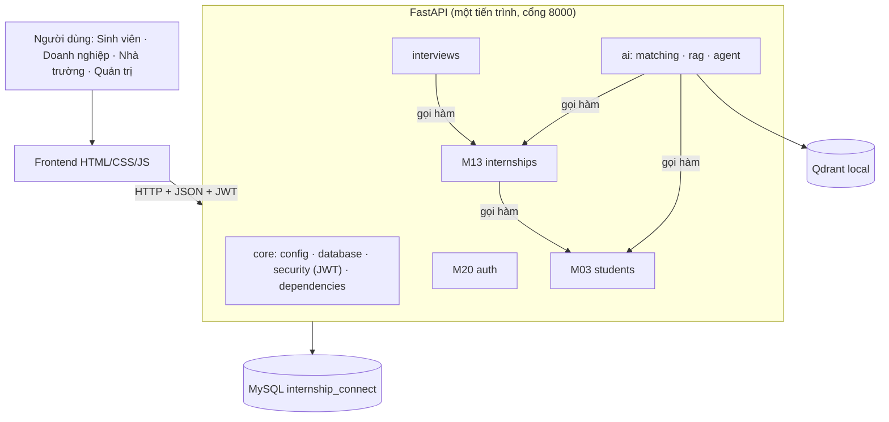

# Kiến trúc hệ thống

Một ứng dụng FastAPI duy nhất, chia module bên trong, dùng chung một database MySQL.

**Luồng sinh viên ứng tuyển:** đăng nhập (M20 trả JWT) → gửi yêu cầu ứng tuyển → `get_current_user` xác định người dùng và vai trò → M13 gọi `students.service` lấy hồ sơ → kiểm tra tin còn mở, còn hạn, chưa ứng tuyển → lưu đơn `pending` → sinh viên xem trạng thái ở `/api/applications/me`.

**Quy tắc phụ thuộc:** module ưu tiên gọi hàm trong `service.py` của module khác (ví dụ `students.service.get_student_by_user_id`) thay vì tự truy vấn bảng của họ. Ngoại lệ hiện có: `interviews` và `ai` đọc trực tiếp model của M13 (`Application`, `Internship`) để join và lập chỉ mục, chỉ đọc, không ghi.
